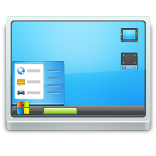

<div align="center">

# 🖥️ DeskMate

**One always-on-top window for the small stuff you copy, paste and launch all day.**

Text list with 15 copy buttons · sticky notes · desktop launcher · screen magnifier ·
script runner · character picker — bundled into a single portable `.exe`.

[](.dev/version_info.txt)
[](#-requirements)
[](#-requirements)
[](#-requirements)
[](#-license)
[](#-testing)

[**Polski**](docs/readme.pl.md) · [Magnifier deep-dive](docs/Magnifier.md) · [Report a bug](https://github.com/polsoft-it)

</div>

---

## 📖 Overview

**DeskMate** (formerly *Desktop Mate*) is a small Windows desktop companion. The main window keeps
**15 text slots**, each with its own copy button, and a top bar that launches the tools you need
while you work — without ever losing your place in another application.

Everything lives in **one process**: the helpers are bundled inside the executable and started from
the top bar, so there is nothing extra to install, no tray icon and no background service.
The interface is available in **English and Polish** and ships with a **dark (Catppuccin Mocha)**
and **light (Visual Studio style)** theme.

> **Design goal:** answer the question *"what do I need at hand right now?"* with one click —
> and never steal focus from the app you are actually working in.

---

## ✨ Features

### 📝 Main window — Text List

- **15 independent text slots**, each with a dedicated **Copy** button (and a "Copied!" confirmation).
- **Bulk paste ➜ split into list** — paste a block of text (lines, `;`/`,`-separated values,
  numbered lists, bullets) and the intelligent splitter distributes it across the 15 slots.
- **Copy all**, **Clear all**, and **Export / Import `.txt`** for the whole list of tables.
- **Autosave** — the list is persisted on every change (debounced), so nothing is lost on exit.
- **Always on top** toggle (`📌`) and a **compact mode** (`🗕`) that shrinks the window to a small
  icon; double-click the icon to restore.
- **Live status bar** — `n/15 filled`, save/export/import confirmations and error messages.
- **Window position, size, always-on-top state, language, theme and hotkeys are all remembered.**

### 🖥️ Top bar — nine tools in one strip

| Button | Tool | What it does |
| :---: | --- | --- |
|  | **Desktop Launcher** | Add apps, shortcuts, folders and scripts to a list or icon grid; right-click for *Add / Add folder / Open / Properties / Remove*. Shows the file's native Windows icon. |
| 🔍 | **Magnifier** | Cursor-following, always-on-top lens (1.5×–20×). Global hooks, filters, freeze frame. |
| `>_` | **psLauncher (mod)** | Pick a `.ps1/.bat/.cmd/.vbs/.js/.wsf/.hta/.py` file and run it, optionally **as Administrator** (UAC prompt). Live output window. |
| ™ | **Character Picker** | 5×5 grid of special characters (`™ © ® § ✓ ∞ ♪ …`); click a cell to copy the character. Editable grid + Windows Character Map shortcut. |
| 🗕 | **Compact** | Collapse to a floating icon; double-click to restore. |
| 📌 | **On top** | Pin the window above other applications. |
| ⚙ | **Settings** | Language, theme, sticky-notes save location, shared table file, and global hotkeys. |
| ℹ | **About** | Author, version, links and the list of bundled apps. |
| 🗑 📋 💾 📂 📝 | **List actions** | Clear, Copy all, Export, Import, Sticky Notes. |

### 🔍 Magnifier — `magnifier.py`

A frameless, always-on-top lens that follows the cursor across **all monitors**, driven by a global
low-level mouse hook so it never needs focus.

- Adaptive rendering: `LANCZOS` below 4×, sharp `NEAREST` + edge-contrast S-curve above 4×.
- Flicker-free (one persistent canvas item), idle-aware (no capture when the cursor is still),
  captures throttled to ~45 fps.
- `Alt` + wheel zooms (1.25× steps), double-click or `Esc` closes, `Ctrl+Alt+L` shows/hides,
  `Ctrl+Alt+F` freezes the frame, `Ctrl+Alt+I` inverts colors, `Ctrl+Alt+C` boosts contrast.
- 📘 Full technical write-up: **[docs/Magnifier.md](docs/Magnifier.md)**

### 📝 Sticky Notes — `sticky_notes.py`

- Multiple free-floating notes, **draggable** by their title bar.
- **8 preset note colors** plus a custom color picker, per-note **always-on-top** pin.
- **Editable title**, live autosave (400 ms debounce) to JSON, per-note delete with confirmation.
- Follows the app language (EN/PL); the storage file location is configurable in **Settings**.

### ⌨️ Global hotkeys — `hotkeys.py`

- Two configurable shortcuts: **show/hide the main window** and **show/hide sticky notes**.
- Each can be a **key combination** (registered system-wide via `RegisterHotKey`, so it works while
  another app has focus) or a **mouse gesture** (click / double-click with optional modifiers).
- Conflicts are detected and reported; shortcuts that the OS refuses are announced and still work
  while the app has focus.

---

## 🚀 Quick Start

### ▶️ Run from source

```powershell
# 1) get the code
git clone https://github.com/polsoft-it/DeskMate.git
cd DeskMate

# 2) install the only third-party dependency
pip install PyQt6

# 3) start the app (no console window)
pythonw DesktopMate.pyw
```

> The magnifier additionally needs **Pillow** (`pip install pillow`) — it is bundled in the `.exe`,
> but a source checkout needs it to run the lens.

### 📦 Portable executable

```powershell
.dev\build.bat
```

The script upgrades PyInstaller, clears `.dev\build` / `.dev\dist`, and produces a **single-file,
windowed** `DeskMate` executable with icon and version metadata:

```
.dev\dist\DesktopMate.exe
```

### 🧩 How the bundled helpers start

The helpers are **not** separate programs. When the app is frozen, clicking a top-bar button
re-runs the executable with a switch, and the child process runs the bundled script instead of
showing the main window:

| Switch | Script |
| --- | --- |
| `--run-magnifier` | `magnifier.py` |
| `--run-pslauncher` | `pslauncher.py` |
| `--run-character-picker` | `character_picker.py` |

The same switch works from a terminal (`DesktopMate.exe --run-pslauncher`), and clicking the button
again terminates the helper and its whole process tree.

---

## ⚙️ Requirements

| Item | Value |
| --- | --- |
| **Operating system** | Windows 10 / 11 (Win32 APIs via `ctypes`, `tkinter`, `os.startfile`) |
| **Python** | 3.10+ (developed and tested on 3.14) |
| **GUI toolkit** | [PyQt6](https://pypi.org/project/PyQt6/) — the main window, launcher, notes, picker |
| **Magnifier** | [Pillow](https://pypi.org/project/pillow/) + `tkinter` (included with the python.org installer) |
| **psLauncher** | `tkinter` only; interpreters it can launch must be on `PATH` |
| **Build (optional)** | PyInstaller (installed by `.dev\build.bat`) |

> If `import tkinter` fails, re-run the Python installer and enable the optional component
> **tcl/tk and IDLE**. `tkinter` cannot be installed with `pip`.

---

## 📁 Project structure

```
DeskMate/
├── DesktopMate.pyw          # entry point: main window, theme, language, settings, helper dispatch
├── desktop_launcher.py      # "Desktop" window: list/grid of apps, entries, properties
├── sticky_notes.py          # sticky notes: note widget + manager + JSON store
├── hotkeys.py               # global keyboard/mouse shortcuts (RegisterHotKey, WH_* hooks)
├── magnifier.py             # screen magnifier (tkinter + Pillow + Win32 hooks)
├── pslauncher.py            # script runner: extension handlers, elevation, output window
├── sandbox.py               # optional sandbox/output module used by psLauncher
├── character_picker.py      # 5×5 special-character picker
├── Desktop.png              # Desktop Launcher icon
├── pslauncher_icon.png      # psLauncher icon
├── resources & data         # text_list_data.json, sticky_notes_data.json, desktop_launcher_data.json
├── tests                   # pytest suite (launcher, notes, pslauncher, magnifier)
├── docs/
│   ├── readme.pl.md         # this README in Polish
│   └── Magnifier.md         # magnifier: rendering pipeline, hooks, internals
└── .dev/
    ├── DesktopMate.spec     # PyInstaller spec (helpers, data files, hidden imports)
    ├── build.bat            # one-command portable build
    ├── version_info.txt     # EXE version metadata (v2.7)
    └── icon.ico             # application icon
```

---

## 🗂️ Data files

DeskMate keeps its state in plain, human-readable JSON files next to the executable
(or next to `DesktopMate.pyw` in a source checkout). Delete a file to reset that part of the app.

| File | Contents |
| --- | --- |
| `text_list_data.json` | 15 slots, bulk text, language, theme, always-on-top, notes path, shared table path, hotkeys, window geometry |
| `sticky_notes_data.json` | All notes: id, title, content, color, position, size, pin state |
| `desktop_launcher_data.json` | Launcher entries: path, display name, custom icon, folder flag |
| `character_settings.json` | The 25 characters of the Character Picker (written on save) |

> The sticky-notes store and the shared table file can be pointed at any folder from **Settings**;
> the notes then follow the chosen file automatically.

---

## 💾 Build & packaging

`.dev\DesktopMate.spec` is the single source of truth for the build:

- **Bundled helpers** — `magnifier.py`, `pslauncher.py`, `sandbox.py`, `character_picker.py`.
  They are executed with `runpy`, so PyInstaller cannot see their imports: the spec
  **AST-scans** every helper and adds its imports (including the full `tkinter` / `PIL`
  submodule trees) as hidden imports.
- **Bundled data** — icons, JSON defaults and `icon.ico` (the window icon is loaded at runtime;
  `EXE(icon=...)` only brands the executable file itself).
- **Single-file, windowed** output (`console=False`, `upx=True`) with icon and version metadata
  from `.dev\version_info.txt`.

Bump the version in **two** places: `ABOUT_INFO["version"]` in `DesktopMate.pyw` and both
`filevers`/`prodvers` + string values in `.dev\version_info.txt`.

---

## 🧪 Testing

The suite runs headless (`QT_QPA_PLATFORM=offscreen`) and never touches the real data files.

```powershell
pip install pytest
python -m pytest
```

| Test module | Covers |
| --- | --- |
| `tests/test_desktop_launcher.py` | entries file location, JSON normalisation and validation, launching, size formatting |
| `tests/test_sticky_notes.py` | note manager, persistence, path switching, language |
| `tests/test_pslauncher.py` | extension → interpreter mapping, shell/admin flags, quoting |
| `tests/test_magnifier.py` | zoom stepping and clamping, crop bounds across the virtual desktop |

---

## 🎨 Themes

Both themes are plain dicts in `DesktopMate.pyw` and are applied through a single generated
stylesheet.

| Theme | Look |
| --- | --- |
| **Dark** (default) | [Catppuccin Mocha](https://github.com/catppuccin/catppuccin) — `#1e1e2e` base, `#89b4fa` accent |
| **Light** | Visual Studio style — `#f3f3f3` base, `#0078d4` accent |

Icons in the top bar are **painted with `QPainter`** and re-themed instantly on theme switch,
so they stay crisp at any DPI.

---

## 🌍 Languages

All user-visible strings live in a single `STRINGS` dict (`en` / `pl`) in `DesktopMate.pyw`;
notes and launcher have their own small string tables. Switching the language is instant and
persisted — no restart required.

---

## ⚠️ Notes & limitations

- **Windows only.** The magnifier, global hotkeys and startup of files rely on Win32 APIs.
- **Elevation** (`psLauncher`) goes through a `Start-Process -Verb RunAs` UAC prompt; declining it
  is reported, not silently ignored.
- **Character Picker** stores its settings in the working directory (`character_settings.json`);
  run it from a writable folder.
- **Launcher entries** point at absolute paths — moving the target breaks the entry (it is skipped
  gracefully instead of crashing).
- **No code signing** — Windows SmartScreen may warn about the unsigned executable.

---

## 🤝 Contributing

1. Fork the repository and create a feature branch.
2. Keep the existing style: one module per tool, user-visible text in the string tables,
   docstrings that explain *why* rather than *what*.
3. Run `python -m pytest` before opening a pull request.
4. Describe the change and attach a screenshot for UI work.

Bug reports and feature ideas are welcome in the
[issue tracker](https://github.com/polsoft-it).

---

## 📄 License

**Freeware** © Sebastian Januchowski · polsoft.ITS™ Group — free to use, including commercially.
No warranty is provided; use at your own risk.

---

<div align="center">

**DeskMate v2.7** · made for people who copy the same twelve things every single day.

[⬆ Back to top](#-deskmate) · [Polski](docs/readme.pl.md)

</div>
